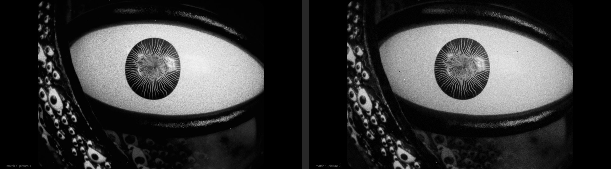

# visual-ab-duel

A [Claude Code](https://claude.com/claude-code) skill for choosing among several close visual options (looks, film
stocks, grades, renders, designs) without bias: a blind pairwise tournament. Claude shows you two full frame pictures
per message, labelled only "match M, picture N", in random pairing and order. You answer 1, 2 or too close, and the
names come out only at the end.

Made for choosing a black and white film look for a music video, among options too close to judge with their names
on them.



(In a duel each picture fills the screen on its own; here both are shown side by side.)

## Install

```sh
git clone https://github.com/juliangruber/visual-ab-duel ~/.claude/skills/visual-ab-duel
```

Claude Code picks it up as a skill: ask it to help you choose between some looks blind, or to run a duel. Needs
Python 3 and pillow (the skill runs it with `uv run --with pillow`). Pictures open in Preview on macOS and with
`xdg-open` elsewhere; `--no-open` only prints their paths.

## How it works

- **Single elimination with byes**, in random pairing and order. A duel of N options takes about N - 1 answers.
- **Too close:** `defer` brings the pair back after another match. The same pair too close again: `reshuffle` pairs
  everything still in anew, avoiding pairs already found too close. With only two left: the pair at other moments
  (`moments`), then as short clips in motion (`clips`).
- **Pictures untouched:** pasted 1:1 and centered on a canvas the size of your screen (scaled down only if larger),
  the label in dim gray in a bar outside the picture. Without room for a bar the numbers are only in the file name, or
  over the picture's corner with `--label over`.
- **Blind:** Claude is told never to name the options or say which one is the current version, and to use `status`
  instead of reading the state in front of you. `reveal` at the end lists every match with names, including the
  deferred and reshuffled pairs and the byes.
- The state folder (`state.json` and the match pictures) is the record of the decision.

## Commands

```
duel.py --state DIR init CANDIDATES.json [--canvas 3840x2160] [--label bar|over|none] [--no-open]
duel.py --state DIR next [--no-open]
duel.py --state DIR record 1|2
duel.py --state DIR defer [--force]
duel.py --state DIR reshuffle [--force]
duel.py --state DIR moments|clips [--no-open]
duel.py --state DIR status
duel.py --state DIR reveal [--force]
```

`CANDIDATES.json` is a list of `{"id": ..., "label": ..., "image": path}`, optionally with `"moments": [{"name": ...,
"image": path}]` and `"clip": path`. `--state` may also come from `DUEL_STATE`. See [SKILL.md](SKILL.md) for the
protocol Claude follows.

## Videos

[video-compare-slider](https://github.com/juliangruber/video-compare-slider) shows each match blind in a synced wipe
slider (its `scripts/duel_slider.py`), so you can play and scrub the pair instead of judging stills.

## License

MIT
